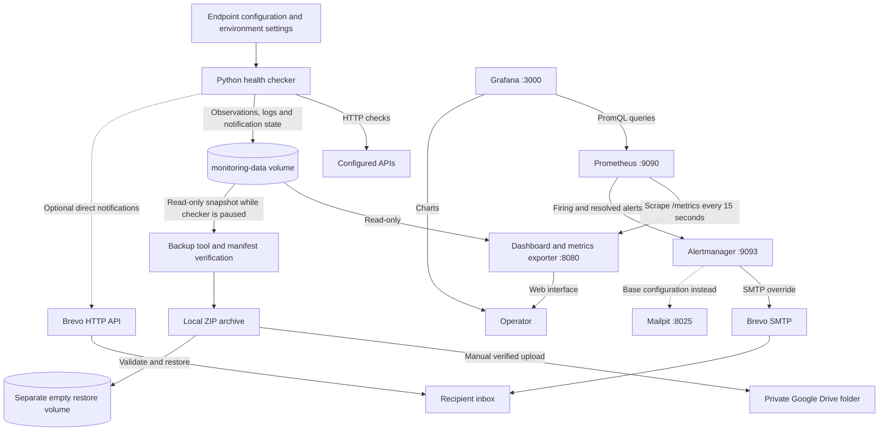

# Project summary and architecture

API Health Checker monitors configured HTTP services, records their availability
and response times, and helps an operator distinguish an API incident from stale
monitoring data. It combines Python application troubleshooting with Docker,
Kubernetes, metrics, dashboards, alert delivery and recovery testing.

## Architecture: recommended Docker Compose deployment

Ports shown are default host ports, bound to localhost. The checker writes the
shared monitoring files; the dashboard reads them without running API checks.
Prometheus has its own sample storage, while Grafana queries Prometheus. Scrape
success confirms exporter access, not API health or checker freshness.

The two email paths are independent. The recommended SMTP override sends
Alertmanager notifications through Brevo; the base configuration sends them to
Mailpit. Checker Brevo API notifications are optional and use separate credentials
and address settings. Enabling both paths can produce duplicate API alerts.

The backup path covers only monitoring files. Google Drive is an archive
destination, not live application storage. Automated upload is not yet verified:
the configured Codex schedule cannot access Docker in its current environment.

## Kubernetes deployment

The Kubernetes option uses one Deployment with one Pod containing the checker
and dashboard. Both mount a shared 1 GiB persistent volume claim; the dashboard's
mount is read-only. Endpoint configuration comes from a generated ConfigMap and
optional credentials from a Secret. An internal Service exposes the dashboard
through port-forwarding. The `Recreate` strategy prevents overlapping writers.

Prometheus, Grafana, Alertmanager and SMTP delivery are not deployed by these
Kubernetes manifests. Compose and Kubernetes have separate monitoring storage.

## Evidence from the project

| Capability | Recorded evidence |
| --- | --- |
| Incident history | Retained incident timestamps and durations across a Compose restart. |
| Persistent Kubernetes storage | CSV check count increased from 22 to 24 across planned Pod replacement. |
| Monitoring freshness | Stopping the checker produced overdue observations; fresh checks cleared the warning. |
| Observability | Prometheus scraping and provisioned Grafana queries worked against collected observations. |
| External notifications | Both firing and resolved overdue-monitoring emails reached the real recipient inbox through Brevo SMTP. |
| Recovery | A verified 1,064-check backup restored into a separate Docker volume and produced readable API statistics. |
| Off-machine copy | A later verified 1,210-check ZIP uploaded privately to Google Drive with matching byte size. |
| Final code review | 63 unit tests passed; dependency compatibility passed; no known Python dependency vulnerabilities reported by the dated audit in the release notes. |

These are specific local test results, not claims of production uptime, complete
disaster recovery, node-failure recovery or high availability.

## Skills demonstrated

- Troubleshooting HTTP errors, timeouts, authentication and SMTP configuration.
- Separating service health from the freshness and availability of monitoring.
- Recording incident evidence and interpreting observed recovery times.
- Deploying non-root containers and retaining data through planned replacement.
- Configuring metrics, dashboards and firing/resolved notifications.
- Verifying backups and testing restoration without replacing live data.
- Using unit tests and CI to validate changes before merging.

For operation, use the [recommended README startup instructions](../README.md#docker-compose-recommended-startup-with-real-email).
For release scope, validation dates and limitations, see [v1.0 release notes](release-notes-v1.0.md).
